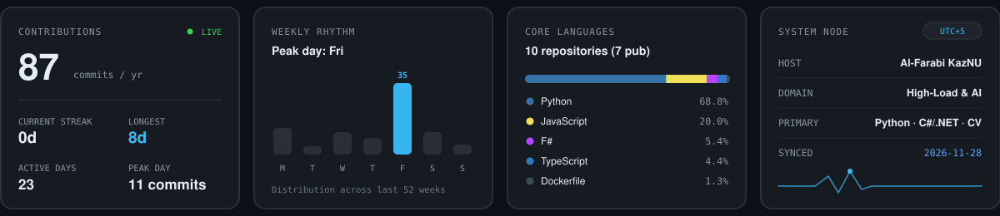
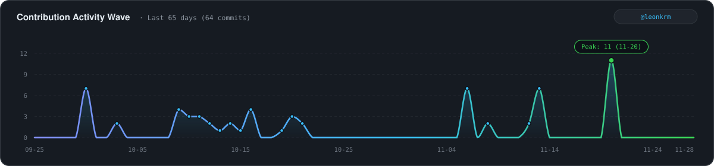
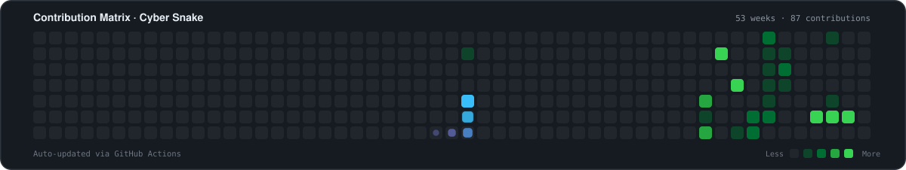

  

<h1 align="center">Hi 👋, I'm Leon</h1>

  <strong>Backend &amp; AI Systems Engineer</strong> · Almaty, Kazakhstan 🇰🇿

  <code>Python · Django · C# / .NET · Computer Vision · High-Load Systems</code>

  Designing fault-tolerant architectures, scalable APIs, and intelligent vision pipelines.

---

<h2 align="center">🧠 Know About Me</h2>

<table>
  <tr>
    <td align="center" valign="middle" width="245">
      
    </td>
    <td valign="middle">
      

        <strong>Leon (Ruslan Kerimbekov)</strong> — 3rd-year student at
        <strong>Al-Farabi Kazakh National University (KazNU)</strong>, Faculty of Information Technology and Artificial Intelligence, specializing in <strong>high-load information systems with AI</strong>.
      

      

        I build production-ready backend APIs in <strong>Python (Django)</strong> and <strong>C# / .NET</strong>, design race-safe concurrent workflows with <strong>PostgreSQL, Redis &amp; Celery</strong>, and experiment with real-time <strong>Computer Vision (YOLO + OpenCV)</strong>.
      

      

        <strong>Core Focus:</strong> 
        
        
        
        
        
        
      

    </td>
  </tr>
</table>

---

<h2 align="center">🤝 Connect</h2>

  
  
  
  

> *"Clean architecture is quiet empathy for your future self — systems built to endure load, not just pass today's tests."*

---

<h2 align="center">⚙️ Tech Stack</h2>

  <picture>
    <source media="(prefers-color-scheme: dark)" srcset="https://skillicons.dev/icons?i=python%2Cdjango%2Ccs%2Cdotnet%2Cpostgres%2Credis%2Cdocker%2Cmongodb%2Cgit%2Cgithub%2Cvscode&theme=dark" />
    <source media="(prefers-color-scheme: light)" srcset="https://skillicons.dev/icons?i=python%2Cdjango%2Ccs%2Cdotnet%2Cpostgres%2Credis%2Cdocker%2Cmongodb%2Cgit%2Cgithub%2Cvscode&theme=light" />
    
  </picture>
   
  <picture>
    <source media="(prefers-color-scheme: dark)" srcset="https://skillicons.dev/icons?i=pytorch%2Ctensorflow%2Copencv%2Cts%2Cjs%2Cangular%2Clinux&theme=dark" />
    <source media="(prefers-color-scheme: light)" srcset="https://skillicons.dev/icons?i=pytorch%2Ctensorflow%2Copencv%2Cts%2Cjs%2Cangular%2Clinux&theme=light" />
    
  </picture>
    
  
  
  
  
  
  

---

<h2 align="center">🛠️ Top Projects</h2>

<table>
  <tr>
    <td valign="middle">
      

        <strong>🤖 <a href="https://github.com/leonkrm/rag-dev-assistant">RAG Dev Assistant</a></strong> 
        <code>Python · TypeScript · Docker</code> — Retrieval-augmented engineering assistant for indexing docs and speeding up developer workflows.
      

      

        <strong>🎟️ <a href="https://github.com/leonkrm/ticket-booking-api">Ticket Booking API</a></strong> &nbsp;<code>🚧 In progress</code> 
        <code>Django REST · PostgreSQL · Redis · Celery</code> — High-load reservation service engineered for race-safe seat locking under concurrency.
      

      

        <strong>🔍 <a href="https://github.com/leonkrm/object-detector">Object Detector</a></strong> &nbsp;<code>🚧 In progress</code> 
        <code>Python · YOLO · OpenCV</code> — Real-time object detection and frame-level inference across images and video streams.
      

      

        <strong>🧪 <a href="https://github.com/leonkrm/sro1-docker-kerimbekov">Dockerized Services</a> &amp; <a href="https://github.com/leonkrm/sro1-fsharp-kerimbekov">F# Systems Labs</a></strong> &nbsp;<code>Public</code> 
        <code>Python · F# · Docker</code> — Public containerization and functional programming architectures.
      

    </td>
    <td align="center" valign="middle" width="245">
      
    </td>
  </tr>
</table>

---

<h2 align="center">📊 Live Telemetry &amp; Contribution Matrix</h2>

  <picture>
    <source media="(prefers-color-scheme: dark)" srcset="assets/bento-stats-dark.svg" />
    <source media="(prefers-color-scheme: light)" srcset="assets/bento-stats-light.svg" />
    
  </picture>

  <picture>
    <source media="(prefers-color-scheme: dark)" srcset="assets/activity-graph-dark.svg" />
    <source media="(prefers-color-scheme: light)" srcset="assets/activity-graph-light.svg" />
    
  </picture>

  <picture>
    <source media="(prefers-color-scheme: dark)" srcset="assets/contrib-snake-dark.svg" />
    <source media="(prefers-color-scheme: light)" srcset="assets/contrib-snake-light.svg" />
    
  </picture>

---

  

