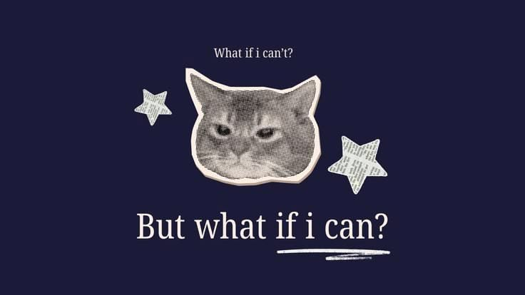

<!-- ==================================================================
  PROFILE README for github.com/leonkrm
  1) Repo must be PUBLIC and named exactly: leonkrm
  2) Keep the folder "assets" with the banner image next to README.md
  3) Optional: add assets/about.png (picture for the About Me block)
     and uncomment the <td> with it below
================================================================== -->

  

<h2 align="center">Hi 👋, I'm Leon</h2>

<h3 align="center">Backend Developer</h3>

<code>Python · Django · .NET · Computer Vision</code>

Building reliable backend systems with clean architecture and scalable solutions.

---

<h2 align="center">🚀 About Me</h2>

<table>
  <tr>
    <td valign="top">

**Leon**, here: a 3rd-year student at **Al-Farabi Kazakh National University** (Faculty of Information Technology and Artificial Intelligence), specializing in **high-load information systems with AI**.

I enjoy building scalable, production-ready APIs with Python and C# / .NET, and continuously improving my understanding of real-world backend systems.

Currently I'm working on a **Ticket Booking API** (Django, PostgreSQL, Redis) and an **Object Detector** (YOLO + OpenCV), while learning **distributed / high-load systems**.

My goal is simple: write clean code, build reliable software, and grow into an engineer who creates systems that last.

</td>
    <!--
    <td align="center">
      
    </td>
    -->
  </tr>
</table>

---

<h2 align="center">🤝 Connect</h2>

  
  
  
  

---

<h2 align="center">💻 Tech Stack</h2>

   
   
  
  
  
  
  
  

---

<h2 align="center">🛠️ Featured Projects</h2>

### 🤖 RAG Dev Assistant
Python · RAG-based assistant for developers
[Repository →](https://github.com/leonkrm/rag-dev-assistant)

### 🎟️ Ticket Booking API &nbsp; `🚧 In progress`
Django REST + PostgreSQL + Redis + Celery + Docker · race-safe seat booking under load
[Repository →](https://github.com/leonkrm/ticket-booking-api)

### 🔍 Object Detector &nbsp; `🚧 In progress`
YOLO + OpenCV · object detection in images and video
[Repository →](https://github.com/leonkrm/object-detector)

---

<h2 align="center">📊 GitHub Stats</h2>

  

---

<h2 align="center">📈 Activity Graph</h2>

  

